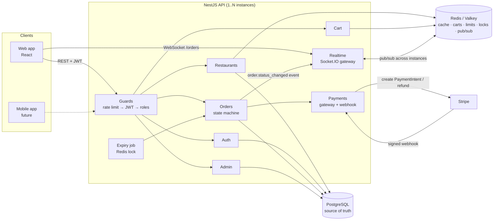
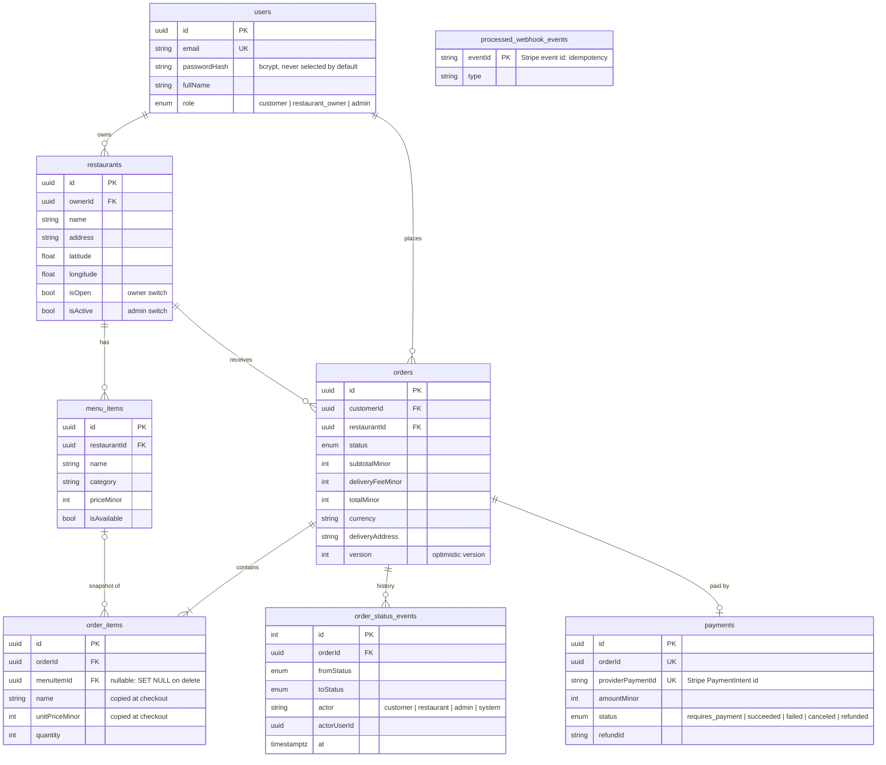
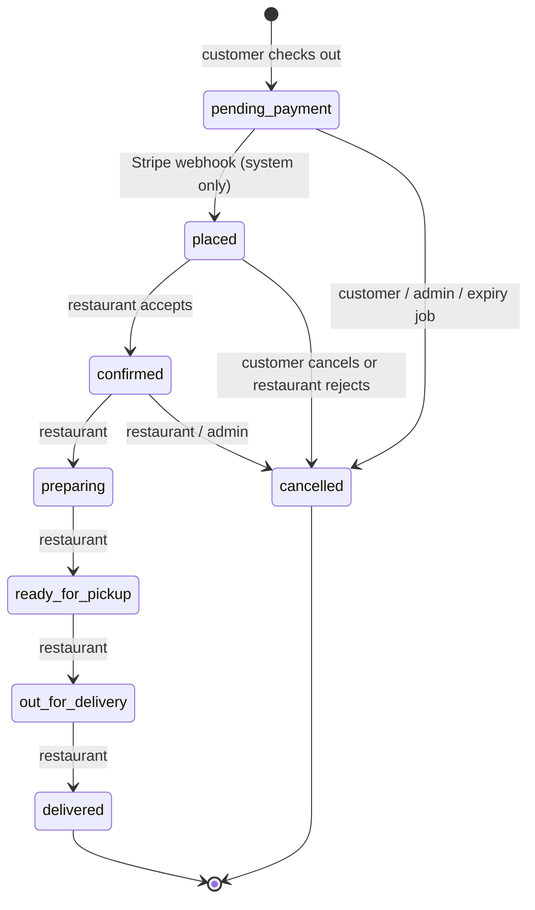

# BiteBridge API

Backend for **BiteBridge**, a food ordering and delivery platform. Customers browse restaurants, build a cart, pay online and track their order live. Restaurants manage menus, work through incoming orders on a live board and see their sales. Admins oversee the whole platform.

The front end is in the companion repo [bitebridge-web](https://github.com/rkparupudi/bitebridge-web).


| | |
|---|---|
| **Language** | TypeScript (strict) on Node.js 22 |
| **Framework** | NestJS 10 |
| **Database** | PostgreSQL 16 via TypeORM, with versioned migrations |
| **Cache and messaging** | Redis / Valkey: caching, carts, rate limits, distributed locks, Socket.IO pub/sub |
| **Payments** | Stripe PaymentIntents and signed webhooks, plus a local simulator |
| **Real time** | Socket.IO (WebSocket) with the Redis adapter |
| **Auth** | JWT bearer tokens, bcrypt password hashing, role-based access |
| **Docs** | Swagger / OpenAPI at `/docs` |
| **Tests** | Jest and Supertest: 42 tests against real PostgreSQL and Redis |
| **Delivery** | Docker, GitHub Actions, AWS (ECS Fargate, RDS, ElastiCache). See [DEPLOYMENT.md](DEPLOYMENT.md) |

---

## Contents

1. [Features](#features)
2. [Architecture](#architecture)
3. [Quick start (local)](#quick-start-local)
4. [Configuration](#configuration)
5. [npm scripts](#npm-scripts)
6. [Project structure](#project-structure)
7. [Data model](#data-model)
8. [Order lifecycle](#order-lifecycle)
9. [Payments](#payments)
10. [Real-time updates](#real-time-updates)
11. [API reference](#api-reference)
12. [Errors](#errors)
13. [Security](#security)
14. [Scalability](#scalability)
15. [Testing](#testing)
16. [Database migrations](#database-migrations)
17. [Troubleshooting](#troubleshooting)
18. [Deployment](#deployment)
19. [Roadmap](#roadmap)

---

## Features

**Customers**
- Browse and search restaurants; view menus grouped by category.
- A cart that holds one restaurant's items, with a "start a new cart?" prompt when switching.
- Checkout with delivery address and notes; prices always come from the database.
- Pay by card through Stripe (or the local simulator).
- Live order tracking over WebSocket; order history.
- Cancel until the restaurant accepts; paid orders are refunded automatically.

**Restaurant owners**
- Create restaurants; open and close them for orders.
- Menu management: add, re-price, mark unavailable, delete.
- Live order board: new paid orders arrive instantly.
- Move orders through the workflow (accept → preparing → ready → out for delivery → delivered) or reject them, with an automatic refund.
- 30-day sales report: revenue, order count and daily breakdown.

**Admins**
- See every order on the platform, filterable by status and restaurant, live.
- Suspend or reinstate restaurants. A suspended restaurant disappears from search and can't take orders.

**Platform**
- Abandoned unpaid orders expire automatically after 30 minutes (configurable).
- Rate limiting, with a stricter limit on login and registration.
- Health probes for load balancers; structured request logs with request IDs.

---

## Architecture



**Request path:** every HTTP request passes three global guards in order:
1. **Rate limit**: counters are stored in Redis, so the limit holds across all instances.
2. **JWT**: every route needs a token unless it's marked `@Public()`, so a forgotten decorator fails closed.
3. **Roles**: `@Roles(...)` restricts a route to customers, owners or admins.

The guards don't check which records you own. Services do that, so an owner can only touch their own restaurants and a customer only their own orders.

**Module layout:** each feature is one NestJS module (entities, DTOs, service and controller together). Modules talk to each other through exported services and in-process events. For example, `OrdersService` emits `order.status_changed` and the WebSocket gateway listens; the orders code never calls Socket.IO directly.

---

## Quick start (local)

### Prerequisites

| Tool | Version | Notes |
|---|---|---|
| Node.js | 22.x | `node -v` |
| Docker Desktop | any recent | runs PostgreSQL and Redis |
| Git | any | |

No Stripe account is needed: `.env.example` uses the built-in payment simulator.

### 1. Start PostgreSQL and Redis

```bash
docker compose up -d postgres redis
```

### 2. Configure

```bash
cp .env.example .env            # Windows PowerShell:  copy .env.example .env
```

The defaults work as they are for local development.

### 3. Install, create tables, seed demo data

```bash
npm install
npm run seed
```

`seed` applies migrations first, then creates:

| Account | Email | Password |
|---|---|---|
| Customer | `customer@bitebridge.dev` | `password123` |
| Restaurant owner | `owner@bitebridge.dev` | `password123` |
| Admin | `admin@bitebridge.dev` | `password123` |

It also creates one open restaurant, *Whitefield Biryani House*, with five dishes.

### 4. Run

```bash
npm run start:dev               # restarts on file changes
```

- API: http://localhost:3000
- Swagger UI: http://localhost:3000/docs
- Health: http://localhost:3000/health/ready

### 5. Run the web app

In the `bitebridge-web` folder, run `npm install` and then `npm run dev`. Open http://localhost:5173 and use the one-click demo logins.

### Try it without the UI

Uses `curl` and [`jq`](https://jqlang.github.io/jq/) (Git Bash or WSL on Windows):

```bash
# sign in
TOKEN=$(curl -s -X POST localhost:3000/auth/login -H 'content-type: application/json' \
  -d '{"email":"customer@bitebridge.dev","password":"password123"}' | jq -r .accessToken)

# browse
RID=$(curl -s localhost:3000/restaurants | jq -r '.[0].id')
ITEM=$(curl -s localhost:3000/restaurants/$RID/menu | jq -r '.items[0].id')

# cart → checkout → pay (simulated)
curl -s -X PUT localhost:3000/cart/items -H "authorization: Bearer $TOKEN" \
  -H 'content-type: application/json' -d "{\"menuItemId\":\"$ITEM\",\"quantity\":2}"
OID=$(curl -s -X POST localhost:3000/orders -H "authorization: Bearer $TOKEN" \
  -H 'content-type: application/json' -d '{"deliveryAddress":"12 ITPL Road, Whitefield"}' | jq -r .order.id)
curl -s -X POST localhost:3000/dev/payments/$OID/simulate -H "authorization: Bearer $TOKEN" \
  -H 'content-type: application/json' -d '{"outcome":"succeeded"}' | jq .status    # "placed"
```

---

## Configuration

All settings come from environment variables. Locally they're read from `.env`. The app **validates its configuration at startup** and refuses to start if something required is missing or unsafe (see [Security](#security)).

| Variable | Required | Default | Purpose |
|---|---|---|---|
| `DATABASE_URL` | yes | — | PostgreSQL connection string |
| `REDIS_URL` | yes | — | Redis/Valkey URL. Use `rediss://` for TLS |
| `JWT_SECRET` | yes | — | Signing key for access tokens. At least 32 characters in production |
| `JWT_EXPIRES_IN` | | `1h` | Token lifetime (`15m`, `1h`, `7d`…) |
| `PORT` | | `3000` | HTTP port |
| `NODE_ENV` | | — | `production` turns on the strict config checks |
| `PAYMENTS_PROVIDER` | | `stripe` | `stripe` or `fake` (local simulator; refused in production) |
| `STRIPE_SECRET_KEY` | in production | — | Stripe secret key (`sk_test_…` / `sk_live_…`) |
| `STRIPE_WEBHOOK_SECRET` | in production | — | Signing secret of the webhook endpoint (`whsec_…`) |
| `STRIPE_PUBLISHABLE_KEY` | for Stripe UI | — | Passed to the web app via `GET /config` |
| `CURRENCY` | | `inr` | ISO currency code, lower case |
| `DELIVERY_FEE_MINOR` | | `4000` | Flat delivery fee in minor units (4000 = ₹40.00) |
| `ORDER_PAYMENT_TIMEOUT_MINUTES` | | `30` | Unpaid orders older than this are cancelled |
| `RATE_LIMIT_PER_MINUTE` | | `300` | Requests per client IP per minute, all routes |
| `AUTH_RATE_LIMIT_PER_MINUTE` | | `10` | Login and registration attempts per IP per minute |
| `DB_POOL_MAX` | | `10` | Max database connections per instance |
| `RUN_MIGRATIONS` | | `true` | Apply pending migrations on startup. Set `false` when the deploy pipeline runs them |
| `CORS_ORIGINS` | in production | all | Comma-separated browser origins allowed to call the API |
| `DATABASE_SSL_CA` | | — | Path to a CA bundle; enables verified TLS to the database (RDS) |
| `DATABASE_SSL` | | — | `true` enables TLS with the system CA store |

> Money is always an **integer in the currency's smallest unit** (paise, cents). `32000` means ₹320.00. Floats are never used for money.

---

## npm scripts

| Script | What it does |
|---|---|
| `npm run start:dev` | Run from TypeScript sources; restarts on changes |
| `npm run build` | Compile to `dist/` |
| `npm start` | Run the compiled build (`node dist/main.js`) |
| `npm test` | Unit and end-to-end tests (needs PostgreSQL and Redis running) |
| `npm run seed` | Apply migrations and insert demo data (safe to re-run) |
| `npm run migration:generate -- src/database/migrations/Name` | Generate a migration from entity changes |
| `npm run migration:run` | Apply pending migrations (development) |
| `npm run migration:revert` | Undo the last migration |
| `node dist/database/migrate.js` | Apply pending migrations once and exit (production) |

---

## Project structure

```
src/
├── main.ts                     # entry point (rawBody on, for Stripe signatures)
├── app.module.ts               # wiring: config, DB, Redis, guards, feature modules
├── app.setup.ts                # shared by main and tests: validation, CORS, helmet,
│                               #   compression, request logs, Socket.IO Redis adapter, Swagger
├── config.validation.ts        # fail-fast configuration checks
├── health.controller.ts        # /health/live and /health/ready
├── common/
│   ├── roles.ts                # Role enum, @Roles, @CurrentUser, RolesGuard
│   ├── redis.module.ts         # shared ioredis client
│   └── redis-throttler.storage.ts  # rate-limit counters in Redis (atomic Lua)
├── auth/auth.module.ts         # register, login, me, JWT strategy, @Public guard
├── users/user.entity.ts
├── restaurants/
│   ├── restaurant.entities.ts  # Restaurant, MenuItem
│   └── restaurants.module.ts   # CRUD, ownership checks, menu + list caching
├── cart/cart.module.ts         # Redis-backed cart, one restaurant per cart
├── orders/
│   ├── order-status.ts         # the state machine (single source of truth)
│   ├── order-status.spec.ts    # its unit tests
│   ├── order.entities.ts       # Order, OrderItem, OrderStatusEvent
│   ├── orders.service.ts       # checkout, transitions, webhook handling, reports
│   ├── orders.module.ts        # controllers: orders, Stripe webhook, dev simulator, /config
│   └── order-expiry.job.ts     # cron + Redis lock: cancel abandoned unpaid orders
├── payments/payments.module.ts # Payment entity, webhook idempotency table,
│                               #   Stripe gateway, fake gateway
├── realtime/orders.gateway.ts  # Socket.IO namespace /orders, rooms, push events
├── admin/admin.module.ts       # admin-only endpoints
└── database/
    ├── data-source.ts          # TypeORM options (+ CLI data source, TLS)
    ├── migrations/             # versioned SQL migrations
    ├── migrate.ts              # one-shot migration runner for deploys
    └── seed.ts                 # demo data
test/
├── app.e2e-spec.ts             # full end-to-end suite (Stripe mode, faked network calls)
└── fake-payments.e2e-spec.ts   # local simulator mode
deploy/
├── ecs-task-definition.json    # AWS ECS Fargate task (ARM64)
└── lightsail/                  # single-server option: compose + Caddy (auto HTTPS)
.github/workflows/
├── ci.yml                      # build + test against Postgres and Redis services
└── deploy.yml                  # ECR → migrations → rolling ECS deploy (OIDC, no keys)
```

---

## Data model



**What lives in Redis (and why it's safe to lose):**

| Key | Contents | TTL | If Redis is flushed |
|---|---|---|---|
| `cart:<userId>` | menu item ids and quantities only | 24 h | Carts empty; no money or orders affected |
| `menu:<restaurantId>` | cached public menu | 5 min | Rebuilt from Postgres on next read |
| `restaurants:public` | cached restaurant list | 30 s | Rebuilt on next read |
| `throttle:{…}` | rate-limit counters | 1 min | Limits reset |
| `lock:expire-unpaid-orders` | expiry job lock | 55 s | Job runs on the next tick |

PostgreSQL is the only source of truth for anything that matters.

---

## Order lifecycle

All status changes go through **one function** (`OrdersService.transition`), which checks the rules in `order-status.ts`, locks the row, writes the history and emits the real-time event.



| From → to | Who may do it |
|---|---|
| `pending_payment → placed` | **system only** (the verified payment webhook) |
| `pending_payment → cancelled` | customer, admin, system (expiry or failed payment setup) |
| `placed → confirmed` | restaurant, admin |
| `placed → cancelled` | customer, restaurant, admin |
| `confirmed → preparing` | restaurant, admin |
| `confirmed → cancelled` | restaurant, admin |
| `preparing → ready_for_pickup → out_for_delivery → delivered` | restaurant, admin |
| anything out of `delivered` or `cancelled` | nobody |

**Rules worth knowing:**
- Only the payment webhook can mark an order paid. The client can't claim it paid.
- Steps can't be skipped. `placed → delivered` returns **409**.
- Each change takes a row lock (`SELECT … FOR UPDATE`). If the customer cancels at the same moment the restaurant accepts, one wins and the other gets a clean **409**.
- **Restaurants never see unpaid orders.** `pending_payment` orders are hidden from the restaurant's list, return 404 to the owner, and aren't pushed to the restaurant's socket room.
- **Cancelling a paid order refunds it** through Stripe automatically. Cancelling an unpaid order cancels the PaymentIntent so it can't be paid later. If a payment lands *after* the customer cancelled, it is refunded automatically.

---

## Payments

```mermaid
sequenceDiagram
    autonumber
    participant C as Customer app
    participant A as API
    participant DB as PostgreSQL
    participant S as Stripe

    C->>A: POST /orders (cart → order)
    A->>DB: insert order (pending_payment) + snapshot items
    A->>S: create PaymentIntent (idempotency key order:<id>:pi)
    S-->>A: id + client_secret
    A-->>C: order + clientSecret
    C->>S: confirm card with Stripe.js (card data never touches our servers)
    S->>A: POST /payments/webhook (signed)
    A->>A: verify signature on raw body
    A->>DB: BEGIN; record event id (dedupe); check amount; payment=succeeded; order→placed; COMMIT
    A-->>C: WebSocket order.updated {status: placed}
```

**Safeguards:**

| Concern | How it's handled |
|---|---|
| Forged webhooks | The `Stripe-Signature` header is verified against the **raw** request body with `STRIPE_WEBHOOK_SECRET`; anything else gets a 400 |
| Duplicate webhooks (Stripe retries) | Each event id is inserted into `processed_webhook_events` **in the same transaction** as its effects; a repeat is a no-op and returns `{"duplicate": true}` |
| Wrong amount | `amount_received` and currency are compared with what we charged; a mismatch is recorded and the order is **not** placed |
| Double charges on retry | Stripe idempotency keys: `order:<id>:pi` for the PaymentIntent, `order:<id>:refund` for refunds |
| Stripe down at checkout | The order is cancelled (`payment_setup_failed`), the cart is kept, and the client gets a 502 to retry |
| Holding DB locks during network calls | The Stripe call happens **outside** the database transaction |
| Declined card | The order stays `pending_payment` and the customer can retry; the payment is marked `failed` |

### Local payments without Stripe

With `PAYMENTS_PROVIDER=fake`:
- `POST /orders` returns a fake PaymentIntent (`pi_fake_…`).
- `POST /dev/payments/:orderId/simulate` with `{"outcome": "succeeded" | "failed"}` builds a Stripe-shaped event and runs it through the **same** webhook handler: idempotency, amount check and real-time push included. Only the signature check is skipped.
- The endpoint returns 404 in Stripe mode, and the app refuses to start with `fake` when `NODE_ENV=production`.

### Using real Stripe test mode locally

1. Set `PAYMENTS_PROVIDER=stripe` and your `sk_test_…` / `pk_test_…` keys in `.env`.
2. Run `stripe listen --forward-to localhost:3000/payments/webhook` and put the printed `whsec_…` in `STRIPE_WEBHOOK_SECRET`.
3. Pay in the web app with `4242 4242 4242 4242` (any future expiry, any CVC). Use `4000 0000 0000 0002` to test a decline.

---

## Real-time updates

Socket.IO namespace **`/orders`**. Authenticate with the same JWT the REST API uses:

```js
import { io } from 'socket.io-client';

const socket = io('http://localhost:3000/orders', {
  auth: { token: accessToken },
  transports: ['websocket'],   // no long-polling → no sticky sessions needed behind a load balancer
});

socket.on('ready', ({ rooms }) => console.log('joined', rooms));
socket.on('order.updated', (e) => console.log(e));
// { orderId, restaurantId, from: 'placed', status: 'confirmed', at: '2026-11-18T09:12:19.344Z' }
```

**Rooms are assigned by the server.** Clients can't choose, so nobody can listen to someone else's orders.

| Who connects | Rooms joined | Hears |
|---|---|---|
| any user | `user:<id>` | updates to their own orders |
| restaurant owner | `restaurant:<id>` for every restaurant they own | every paid order for those restaurants |
| admin | `admins` | every order |

- An invalid or missing token gets an `error` event and is disconnected.
- A restaurant created while the owner is connected is joined live; no reconnect needed.
- With several API instances, the **Redis adapter** relays events between them, so a status change handled on instance A reaches a client connected to instance B.

---

## API reference

Interactive documentation with every schema: **http://localhost:3000/docs**.

All bodies are JSON. Authenticated routes need `Authorization: Bearer <accessToken>`.

### Auth

| Method | Path | Access | Body |
|---|---|---|---|
| POST | `/auth/register` | public | `{ email, password (8–72), fullName, role?: "customer" \| "restaurant_owner" }` |
| POST | `/auth/login` | public | `{ email, password }` |
| GET | `/auth/me` | signed in | — |

Admins can't self-register; they're created by the seed script or directly in the database.

Example response from `POST /auth/login`:

```json
{
  "accessToken": "eyJhbGciOiJIUzI1NiIsInR5cCI6IkpXVCJ9…",
  "user": {
    "id": "f7bd1300-2e01-4a77-ba3d-cc4652ba6d5d",
    "email": "customer@bitebridge.dev",
    "fullName": "Asha Customer",
    "role": "customer"
  }
}
```

### Restaurants and menus

| Method | Path | Access | Notes |
|---|---|---|---|
| GET | `/restaurants?q=` | public | Active restaurants; `q` searches by name; open ones first |
| GET | `/restaurants/:id/menu` | public | Restaurant + **available** items; cached in Redis |
| GET | `/restaurants/mine` | owner | Restaurants you own |
| POST | `/restaurants` | owner | `{ name, address, description?, latitude?, longitude? }`; starts **closed** |
| PATCH | `/restaurants/:id` | owner of it, admin | Any field above, plus `isOpen` |
| GET | `/restaurants/:id/menu-items` | owner of it, admin | All items, including unavailable ones |
| POST | `/restaurants/:id/menu-items` | owner of it, admin | `{ name, priceMinor, category?, description?, isAvailable? }` |
| PATCH | `/restaurants/:id/menu-items/:itemId` | owner of it, admin | Any field above |
| DELETE | `/restaurants/:id/menu-items/:itemId` | owner of it, admin | 204; past orders keep their snapshot |

Example response from `GET /restaurants/:id/menu` (trimmed):

```json
{
  "restaurant": {
    "id": "cbf0334d-1680-4ba1-aed4-dc3951351609",
    "name": "Whitefield Biryani House",
    "description": "Dum biryani and kebabs",
    "address": "ITPL Main Road, Whitefield, Bengaluru",
    "latitude": 12.9855,
    "longitude": 77.731,
    "isOpen": true,
    "isActive": true
  },
  "items": [
    {
      "id": "1524fff4-0c8a-4a7f-bb89-5d31046c8312",
      "name": "Chicken Dum Biryani",
      "category": "Biryani",
      "priceMinor": 32000,
      "isAvailable": true
    }
  ]
}
```

### Cart (customer)

| Method | Path | Notes |
|---|---|---|
| GET | `/cart` | Current cart with live prices |
| PUT | `/cart/items?replace=true` | `{ menuItemId, quantity (0–50) }`. Quantity 0 removes the line. Adding from another restaurant returns **409** unless `replace=true` |
| DELETE | `/cart` | 204 |

The cart stores only ids and quantities. Names and prices are read from the database each time, so a client can't set its own price and price changes show up immediately.

```json
{
  "restaurantId": "cbf0334d-1680-4ba1-aed4-dc3951351609",
  "restaurant": { "id": "cbf0…", "name": "Whitefield Biryani House", "isOpen": true, "isActive": true },
  "lines": [
    {
      "menuItemId": "1524fff4-0c8a-4a7f-bb89-5d31046c8312",
      "name": "Chicken Dum Biryani",
      "unitPriceMinor": 32000,
      "quantity": 2,
      "lineTotalMinor": 64000,
      "isAvailable": true
    }
  ],
  "subtotalMinor": 64000
}
```

### Orders

| Method | Path | Access | Notes |
|---|---|---|---|
| POST | `/orders` | customer | Checkout: `{ deliveryAddress (5–500), notes? }`. Returns the order and the payment `clientSecret` |
| GET | `/orders?limit=&offset=` | customer | Your orders, newest first (max 50 per page) |
| GET | `/orders/:id` | the customer, the restaurant (once paid), admin | Items, status history and payment status |
| GET | `/orders/:id/payment` | customer | Fresh `clientSecret` to resume paying a `pending_payment` order |
| PATCH | `/orders/:id/status` | owner, admin | `{ status }`: the next step in the lifecycle |
| POST | `/orders/:id/cancel` | customer, owner, admin | `{ reason? }`; lifecycle rules apply; refunds automatically |
| GET | `/restaurants/:id/orders?status=&limit=&offset=` | owner of it, admin | Excludes unpaid orders |
| GET | `/restaurants/:id/sales?from=&to=` | owner of it, admin | Delivered orders; defaults to the last 30 days |

Example response from `POST /orders` (trimmed):

```json
{
  "order": {
    "id": "08917bce-6346-4f95-9b6f-bf0a706f2103",
    "status": "pending_payment",
    "subtotalMinor": 64000,
    "deliveryFeeMinor": 4000,
    "totalMinor": 68000,
    "currency": "inr",
    "deliveryAddress": "Flat 402, Prestige Shantiniketan, Whitefield",
    "notes": "Less spicy",
    "items": [
      { "name": "Chicken Dum Biryani", "unitPriceMinor": 32000, "quantity": 2 }
    ],
    "history": [
      { "fromStatus": null, "toStatus": "pending_payment", "actor": "customer", "at": "2026-11-18T09:12:19.210Z" }
    ],
    "payment": { "status": "requires_payment", "refunded": false }
  },
  "payment": {
    "provider": "stripe",
    "paymentIntentId": "pi_3Q…",
    "clientSecret": "pi_3Q…_secret_…"
  }
}
```

Example response from `GET /restaurants/:id/sales`:

```json
{
  "restaurantId": "cbf0334d-1680-4ba1-aed4-dc3951351609",
  "currency": "inr",
  "from": "2026-10-19T09:12:19.713Z",
  "to": "2026-11-18T09:12:19.713Z",
  "totalOrders": 1,
  "totalRevenueMinor": 70000,
  "days": [{ "day": "2026-11-18", "orders": 1, "revenueMinor": 70000 }]
}
```

Revenue is the food subtotal of delivered orders; delivery fees are excluded.

### Payments

| Method | Path | Access | Notes |
|---|---|---|---|
| POST | `/payments/webhook` | Stripe (signature) | Handles `payment_intent.succeeded` and `payment_intent.payment_failed`; other events are recorded and ignored. Not rate-limited |
| POST | `/dev/payments/:orderId/simulate` | customer, **fake mode only** | `{ outcome: "succeeded" \| "failed" }` |

### Admin

| Method | Path | Notes |
|---|---|---|
| GET | `/admin/orders?status=&restaurantId=&limit=&offset=` | All orders (max 200 per page) |
| GET | `/admin/restaurants` | All restaurants, with owner |
| PATCH | `/admin/restaurants/:id/active` | `{ isActive: boolean }`: suspend or reinstate |

### Platform

| Method | Path | Notes |
|---|---|---|
| GET | `/config` | Public settings the web app needs: `paymentsProvider`, `stripePublishableKey`, `currency`, `deliveryFeeMinor` |
| GET | `/health/live` | Process is up (container health check) |
| GET | `/health/ready` (or `/health`) | PostgreSQL and Redis reachable (load balancer check); 503 otherwise |
| GET | `/docs` | Swagger UI |

---

## Errors

Errors use NestJS's standard shape:

```json
{ "statusCode": 409, "error": "Conflict", "message": "Cannot move an order from placed to delivered as restaurant" }
```

Validation errors list every problem:

```json
{ "statusCode": 400, "error": "Bad Request",
  "message": ["email must be an email", "password must be longer than or equal to 8 characters"] }
```

| Status | Meaning here |
|---|---|
| 400 | Invalid body or query, unknown fields, empty cart at checkout, bad webhook signature |
| 401 | Missing, invalid or expired token; wrong email or password (same message for both) |
| 403 | Signed in but the wrong role, or not the owner of that restaurant |
| 404 | Not found, **or exists but isn't yours** (the API doesn't reveal other people's order ids) |
| 409 | Business rule conflict: illegal status change, cart from another restaurant, restaurant closed, item unavailable, email taken |
| 429 | Rate limit exceeded |
| 502 | Payment provider unreachable at checkout |
| 503 | `/health/ready` when the database or Redis is down |

---

## Security

| Area | Measure |
|---|---|
| Authentication | JWT (HS256) with expiry; bcrypt (cost 12) password hashes; hashes are never selected by default |
| Authorization | Global guards: every route needs a token unless `@Public()`; role checks via `@Roles`; ownership checks in services |
| Account enumeration | Identical error for unknown email and wrong password; 404 rather than 403 for other people's orders |
| Brute force | 10 login/registration attempts per IP per minute (configurable), enforced across instances |
| Input | `ValidationPipe` with `whitelist` + `forbidNonWhitelisted`: unknown fields are **rejected**, which blocks mass assignment (e.g. sending `ownerId` or `priceMinor`) |
| Prices | The server computes every total from the database; the client never sends a price |
| Payments | Signed webhooks, idempotency, amount verification; card data never reaches this API (Stripe.js) |
| Real time | Socket rooms assigned by the server from the verified JWT |
| Transport | `helmet` security headers; CORS allow-list in production; verified TLS to RDS; `rediss://` for Valkey |
| Configuration | Startup refuses: fake payments in production, a JWT secret under 32 characters, missing Stripe keys or CORS allow-list |
| Secrets | Never in the repo; `.env` is git-ignored; in AWS they come from SSM Parameter Store |
| Container | Runs as the non-root `node` user |

---

## Scalability

The API is **stateless**, so you can run as many instances as you like behind a load balancer.

| Concern | Solution |
|---|---|
| Sessions | JWTs, no server sessions; carts in Redis |
| WebSockets across instances | Socket.IO Redis adapter (pub/sub); WebSocket-only transport so no sticky sessions |
| Rate limits across instances | Counters in Redis via an atomic Lua script; keys use hash tags so it also works on clustered Redis |
| Scheduled jobs on many instances | Every instance runs the cron; a Redis `SET NX PX` lock with compare-and-delete release ensures one does the work |
| Hot reads | Restaurant list (30 s) and menus (5 min) cached in Redis, invalidated on every write |
| Concurrent writes | Row locks for status changes; unique constraints for payments and webhook events |
| Database connections | Pool per instance (`DB_POOL_MAX`); size it so instances × pool stays under the server's `max_connections` |
| Deploys | Migrations run once per deploy (`migrate.js`), then a rolling update gated by `/health/ready` |
| Query performance | Composite indexes on `orders(restaurantId, status, createdAt)` and `orders(customerId, createdAt)` |

---

## Testing

```bash
docker compose up -d postgres redis     # the tests use real databases
npm test
```

The end-to-end tests expect PostgreSQL on `localhost:5432` (user and password `bitebridge`, database **`bitebridge_test`**) and Redis on `localhost:6379`. They wipe and recreate that test database on every run, so your development data in `bitebridge` is never touched.

`docker compose` creates `bitebridge_test` automatically the first time the Postgres volume is initialised. If your volume existed before that, create it once:

```bash
docker compose exec postgres psql -U bitebridge -c "CREATE DATABASE bitebridge_test;"
```

**What's covered (42 tests):**

| Suite | Covers |
|---|---|
| `order-status.spec.ts` (unit) | Every lifecycle rule: who can move what, no skipping, terminal states |
| `app.e2e-spec.ts` | Auth and roles, no password leaks, same error for bad email or password, ownership, unknown-field rejection, menu cache invalidation, cart pricing and single-restaurant rule, checkout, unpaid orders hidden from restaurants, **forged webhook rejected**, **wrong amount ignored**, **duplicate webhook ignored**, real-time delivery only to the right sockets, full lifecycle, no skipping steps, sales report, refunds on cancel, payment after cancel refunded, restaurant reject, Stripe down at checkout, expiry job, health probes, owner joins a new restaurant's room live, login rate limiting, admin suspension |
| `fake-payments.e2e-spec.ts` | Local simulator: decline then succeed, through the real webhook handler |

Only Stripe's *network* calls are faked; webhook signatures are generated and verified with Stripe's own SDK.

CI (`.github/workflows/ci.yml`) runs the build and all tests on every push, against PostgreSQL and Redis service containers.

---

## Database migrations

Schema changes are versioned SQL migrations in `src/database/migrations`. TypeORM's `synchronize` is **off**, so the schema only changes through reviewed files in git.

```bash
# 1. change an entity, then:
npm run migration:generate -- src/database/migrations/AddRestaurantPhone
# 2. review the generated SQL, then apply:
npm run migration:run
```

- Locally, the app applies pending migrations on startup (`RUN_MIGRATIONS=true`).
- In production, the deploy pipeline runs `node dist/database/migrate.js` once as a one-off task **before** new containers start, and the service runs with `RUN_MIGRATIONS=false`. Several containers starting together never race.

---

## Troubleshooting

| Symptom | Fix |
|---|---|
| `Invalid configuration: DATABASE_URL is required` | Create `.env` from `.env.example` in the repo root |
| `ECONNREFUSED 127.0.0.1:5432` / `:6379` | Start the containers: `docker compose up -d postgres redis` |
| `relation "users" does not exist` | Run `npm run seed` (applies migrations) or start the app once |
| Port 5432 already in use | Another PostgreSQL is running locally. Stop it, or change the port mapping in `docker-compose.yml` and `DATABASE_URL` |
| Tests fail with `database "bitebridge_test" does not exist` | Create it (see [Testing](#testing)) |
| Web app shows "Connecting…" instead of "Live" | The API isn't running on :3000, or the token expired. Sign out and back in |
| Webhook returns 400 "Invalid Stripe signature" | `STRIPE_WEBHOOK_SECRET` must be the `whsec_…` printed by `stripe listen` (or from the dashboard endpoint), and nothing may modify the body in between |
| 429 Too Many Requests while developing | Raise `RATE_LIMIT_PER_MINUTE` / `AUTH_RATE_LIMIT_PER_MINUTE` in `.env` |
| `--watch` not supported | Update to Node.js 22 |

---

## Deployment

See **[DEPLOYMENT.md](DEPLOYMENT.md)**:

- **Option A, about $12/month:** one Lightsail server with Docker Compose and Caddy (automatic HTTPS).
- **Option B, about $80–90/month:** ECS Fargate (ARM), RDS PostgreSQL, ElastiCache Valkey, S3 + CloudFront for the web app, and GitHub Actions deploys with OIDC (no stored AWS keys). Migrations run once per deploy, then a rolling update with automatic rollback.

---

## Roadmap

- **Delivery fee by distance:** Google Maps Distance Matrix at checkout (restaurants already store coordinates).
- **Delivery partner role:** riders who pick up `ready_for_pickup` orders and own the last two steps.
- **Refresh tokens and logout:** short-lived access tokens, rotating refresh tokens, a Redis denylist.
- **Transactional outbox:** write events in the same transaction as the status change and publish from the table, so an event is never lost between commit and emit.
- **Mobile app:** React Native on the same REST API and socket namespace.
- **Infrastructure as code:** Terraform or AWS CDK for the setup in DEPLOYMENT.md.

---

## License

[MIT](LICENSE)
